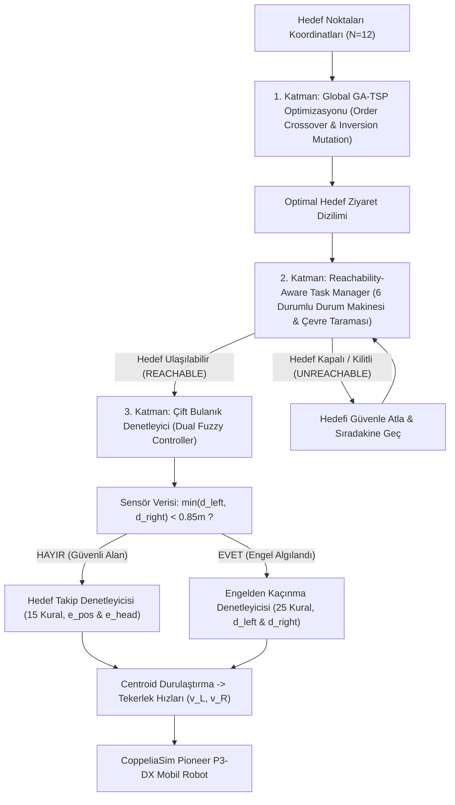

# Çoklu Hedef Otonom Mobil Robot Navigasyonu için Çift Bulanık Mantık ve Genetik Algoritma Tabanlı Kontrol ile Erişilebilirlik Farkındalıklı Görev Yönetimi
*(Reachability-Aware Autonomous Multi-Goal Mobile Robot Navigation via Dual Fuzzy Logic and Genetic Algorithm)*

[](https://www.python.org/)
[](https://www.coppeliarobotics.com/)
[](https://www.coppeliarobotics.com/)
[](LICENSE)
[](https://doi.org/10.3390/s25020446)

---

## 1. Project Title (Proje Başlığı)
**Çoklu Hedef Otonom Mobil Robot Navigasyonu için Çift Bulanık Mantık ve Genetik Algoritma Tabanlı Kontrol Stratejisi ile Erişilebilirlik Farkındalıklı Görev Yönetimi**  
*(Dual Fuzzy Logic and Genetic Algorithm-Based Control Strategy for Multi-Goal Autonomous Robot Navigation with Reachability-Aware Task Management)*

---

## 2. Student Information (Öğrenci Bilgileri)
* **Öğrenci Adı Soyadı:** Adnan Emir Kırılmış
* **E-posta:** [emirkirimis5101@gmail.com](mailto:emirkirimis5101@gmail.com)
* **GitHub Kullanıcı Adı:** [@adnanemir04](https://github.com/adnanemir04)
* **Ders:** Bulanık Mantık ve Yapay Zeka Sistemleri (Bulanık Mantık Projesi 2026-2027)
* **Eğitmen:** Prof. Dr. Rüya ŞAMLI
* **Asistan Eğitmen:** Arş. Gör. Tolgahan ÖZTÜRK
* **Teknik Proje Raporu (11 Sayfa, IEEE):** [report/report.pdf](report/report.pdf) | [report/README.md](report/README.md)
* **Akademik Proje Sunumu (12 Slayt):** [presentation/presentation.pdf](presentation/presentation.pdf) | [presentation/README.md](presentation/README.md)

---

## 3. Original Paper (Referans Makale)
* **Makale Başlığı:** *A Fuzzy Control Strategy for Multi-Goal Autonomous Robot Navigation*
* **Yazarlar:** Stavros Stavrinidis, Paraskevi Zacharia, Elias K. Xidias
* **Akademik Editörler:** Stefano Quer, Qirong Tang
* **Dergi:** *Sensors* (MDPI), Cilt 25, Sayı 2, Madde 446 (Ocak 2025)
* **DOI:** [10.3390/s25020446](https://doi.org/10.3390/s25020446)
* **PMCID:** [PMC11769363](https://pmc.ncbi.nlm.nih.gov/articles/PMC11769363/)
* **Açık Erişim Makale Bağlantısı:** [https://www.mdpi.com/1424-8220/25/2/446](https://www.mdpi.com/1424-8220/25/2/446)
* **Referans Dokümantasyonu:** Detaylı kaynakça ve BibTeX kaydı [references/README.md](references/README.md) dosyasında mevcuttur.

### Makalenin Özeti ve Kapsamı
Referans makale, çoklu hedefli otonom mobil robot navigasyonunda iki aşamalı hibrit bir yaklaşım önermektedir:
1. **Global Seviye:** Ziyaret edilecek hedef noktalarının Gezgin Satıcı Problemi (Traveling Salesperson Problem - TSP) olarak modellenip Genetik Algoritma (GA) ile sıralanması.
2. **Yerel Seviye:** Sıralanan hedeflere doğru robotun sürüşünü sağlayan Hedef Takip Bulanık Denetleyicisi (15 kural) ile rotada karşılaşılan engellerden kaçınmayı sağlayan Engelden Kaçınma Bulanık Denetleyicisinin (25 kural) hiyerarşik entegrasyonu. Deneyler CoppeliaSim ortamında Pioneer P3-DX robotu üzerinde yürütülmüştür.

---

## 4. Problem Description (Problem Tanımı)
Endüstriyel depolarda, lojistik merkezlerinde ve tehlikeli denetim sahalarında mobil robotların önceden tanımlanmış birden fazla hedef noktayı minimum sürede ve minimum enerji tüketimiyle ziyaret ederek başlangıç üssüne (depot) dönmesi hedeflenmektedir. Bu süreçte karşılaşılan temel zorluklar:

1. **Kombinatoryal NP-Hard TSP Karmaşıklığı:** $N$ adet hedefin ziyaret sırası $(N-1)! / 2$ farklı permütasyon barındırır. $N=12$ hedef için 19.9 milyondan fazla alternatif rota söz konusudur; bu nedenle sezgisel Genetik Algoritma ile optimum rotanın bulunması gerekir.
2. **Bilinmeyen ve Değişken Ortam Dinamikleri:** Robot hedefe doğru ilerlerken rotasında öngörülemeyen statik engeller (kolonlar, kutular, duvarlar) ve hareketli dinamik engeller (insanlar, forkliftler) belirebilir.
3. **Literatürdeki Kritik Boşluk (Ulaşılamaz Hedefler ve Kilitlenme):** Standart reaktif bulanık mantık algoritmaları, hedefin 4 duvarla tamamen kapatılmış kapalı bir odada hapsolduğu veya geçici engellerle tamamen bloke edildiği senaryolarda engelden kaçınma döngüsüne girerek duvara çarpmakta ya da yerel asgaride (local minima) kilitlenmektedir.

---

## 5. Method (Kullanılan Yöntem)
Projede global optimizasyon, görev seviyesi analiz ve yerel bulanık kontrolü birleştiren 3 katmanlı hiyerarşik bir kontrol mimarisi tasarlanmıştır:



### 5.1. Diferansiyel Sürüş Robot Kinematiği
Pioneer P3-DX diferansiyel tahrikli bir robottur. Tekerlek yarıçapı $r$ ve tekerlek tabanı mesafesi $L$ olmak üzere robotun doğrusal hızı $v$ ve açısal hızı $\omega$:
$$v = \frac{r (v_R + v_L)}{2}, \quad \omega = \frac{r (v_R - v_L)}{L}$$

### 5.2. Genetik Algoritma ile TSP Çözümü (`src/ga_tsp.py`)
* **Kromozom Temsili:** 12 hedefin tamsayı indis permütasyonu.
* **Uygunluk Fonksiyonu:** $F(\pi) = 1.0 / (\text{Toplam Tur Uzunluğu})$.
* **Çaprazlama:** Sıralı Çaprazlama (Order Crossover - OX).
* **Mutasyon:** Ters Çevirme Mutasyonu (Inversion Mutation).

---

## 6. Fuzzy System Architecture (Bulanık Mantık Sistem Yapısı)
Sistem, `src/fuzzy_controller.py` modülü içinde iki uzman Mamdani bulanık çıkarım sisteminden meydana gelir:

### 6.1. Hedef Takip Bulanık Denetleyicisi (Tracking Controller)
Robotun hedef noktaya yönelmesini ve yaklaşmasını sağlar.
* **Girdi 1: Konum Hatası ($e_{pos}$):** Robot ile hedef arasındaki Öklid mesafesi: $e_{pos} = \sqrt{(x_g - x)^2 + (y_g - y)^2}$.
  * *Small* ($[0.0, 0.8]$ m), *Medium* ($[0.4, 1.8]$ m), *Large* ($[1.4, 4.0+]$ m).
* **Girdi 2: Yönelim Hatası ($e_{head}$):** Hedef açısı ile robot yönelimi arasındaki açı farkı: $e_{head} = \text{atan2}(y_g - y, x_g - x) - \theta$.
  * *NB* (Negatif Büyük), *NS* (Negatif Küçük), *Z* (Sıfır), *PS* (Pozitif Küçük), *PB* (Pozitif Büyük).
* **Çıktılar:** Sol tekerlek hızı ($v_L$) ve Sağ tekerlek hızı ($v_R$).
  * *Slow* ($0.5$ rad/s), *Medium* ($1.5$ rad/s), *Fast* ($2.5$ rad/s).
* **Kural Tabanı (15 Mamdani Kuralı):**

| $e_{head}$ \ $e_{pos}$ | Small ($v_L, v_R$) | Medium ($v_L, v_R$) | Large ($v_L, v_R$) |
|---|:---:|:---:|:---:|
| **NB (Sola Sert Dönüş)** | Slow, Fast | Slow, Fast | Slow, Fast |
| **NS (Sola Yumuşak Dönüş)** | Slow, Med | Med, Fast | Med, Fast |
| **Z (Düz İleri)** | Slow, Slow | Med, Med | Fast, Fast |
| **PS (Sağa Yumuşak Dönüş)** | Med, Slow | Fast, Med | Fast, Med |
| **PB (Sağa Sert Dönüş)** | Fast, Slow | Fast, Slow | Fast, Slow |

### 6.2. Engelden Kaçınma Bulanık Denetleyicisi (Avoidance Controller)
Robotun önündeki 6 ultrasonik sensör iki ana sektöre indirgenir:
$$d_{left} = \min(s_3, s_4), \quad d_{right} = \min(s_5, s_6)$$
* **Girdiler:** $d_{left}$ ve $d_{right}$ $[0.0, 2.0]$ metre aralığında 5 yamuk/üçgen üyelik fonksiyonu:
  * *Very Close (VC)*, *Close (C)*, *Medium (M)*, *Far (F)*, *Safe (S)*.
* **Güvenlik Eşiği:** $\min(d_{left}, d_{right}) < 0.85$ m olduğunda kaçınma denetleyicisi devreye girer.
* **Kural Tabanı (25 Mamdani Kuralı):**
  * Sol taraf tıkalı, sağ taraf açık ise sağ tekerlek yavaşlar, sol hızlanır (sağa kaçış).
  * Sağ taraf tıkalı, sol açık ise sol tekerlek yavaşlar, sağ hızlanır (sola kaçış).
  * Her iki sektör de çok yakınsa (kafa kafaya engel) robot geri çekilerek (ters yönde tekerlek hızları) engelden uzaklaşır.
* **Durulaştırma Metodu:** Ağırlık Merkezi (Centroid / Center of Gravity) yöntemi kullanılmıştır.

---

## 7. Dataset (Veri Seti)
Projede simülasyon ortamı, hedef koordinatları ve deneysel kayıtlar olmak üzere üç tür veri seti bulunmaktadır:

1. **Harita ve Ortam Veri Seti:**
   * Makaledeki koordinatlara birebir sadık kalınarak oluşturulmuş $12.0\text{ m} \times 12.0\text{ m}$ kapalı simülasyon odası.
   * Duvar sınırları, koridorlar, statik engeller ve dinamik yayalar.
2. **Hedef Noktaları Koordinat Seti (N=12 + Depot):**
   * Başlangıç Üssü (Depot): `[-2.65, -3.10]`
   * Hedefler: Makaledeki 12 stratejik nokta `[-2.48, -0.95]`, `[-1.63, 0.10]`, `[-0.83, -0.60]`, `[-1.48, -1.60]`, `[0.07, -1.95]`, `[0.72, -0.80]`, `[0.67, 0.95]`, `[1.27, -1.95]`, `[2.17, -1.95]`, `[2.32, -1.50]`, `[2.32, -0.70]`, `[2.32, 0.50]`.
3. **Telemetri ve Deneysel Ölçüm Veri Setleri:**
   * [`data/navigation_results.csv`](data/navigation_results.csv): 800+ adımlık anlık robot zamanı, $x, y, \theta$ pozisyonu, $e_{pos}, e_{head}$ hata değerleri, $v_L, v_R$ motor hızları ve minimum sensör mesafesi (117 KB).
   * [`data/benchmark_results.csv`](data/benchmark_results.csv): 5 temel test senaryosunun 10'ar tekrarlı süre, yol uzunluğu ve başarı metrikleri.
   * [`data/reachability_task_results.csv`](data/reachability_task_results.csv): Özgün görev yöneticisinin 12 hedef üzerindeki durum geçişleri, deneme sayıları, kat edilen mesafeler ve durum gerekçeleri.
   * [`results/tables/reachability_benchmark_comparison.csv`](results/tables/reachability_benchmark_comparison.csv): 6 senaryoda 3 yöntemin (A, B, C) karşılaştırmalı sayısal sonuç tablosu.

---

## 8. Installation (Kurulum)

### 8.1. Ön Gereksinimler
* **İşletim Sistemi:** Windows 10/11 (Linux ve macOS üzerinde de Python betikleri çalıştırılabilir).
* **Python Sürümü:** Python 3.10, 3.11, 3.12 veya 3.13 (64-bit).
* **Simülatör:** [CoppeliaSim Edu v4.9.0](https://www.coppeliarobotics.com/downloads) (veya v4.6+).

### 8.2. Sanal Ortam Oluşturma ve Bağımlılıkların Yüklenmesi
```powershell
# 1. Proje ana dizinine gidin
cd c:\Users\emirk\OneDrive\Desktop\PythonProject\fuzzy-logic-project

# 2. Python sanal ortamı oluşturun ve etkinleştirin
python -m venv .venv
.venv\Scripts\activate

# 3. Gerekli kütüphaneleri requirements.txt üzerinden kurun
pip install -r requirements.txt
```

*Alternatif olarak Conda kullanıyorsanız:*
```powershell
conda env create -f environment.yml
conda activate fuzzy-logic-project
```

---

## 9. Requirements (Gereksinimler)
Tüm kütüphaneler ve test edilen kesin sürümleri [`requirements.txt`](requirements.txt) dosyasında belirtilmiştir:

| Paket Adı | Kesin Sürüm | Kullanım Amacı |
|---|:---:|---|
| `coppeliasim-zmqremoteapi-client` | `2.0.4` | CoppeliaSim simülatörü ile ZeroMQ üzerinden çift yönlü haberleşme |
| `pyzmq` | `27.2.0` | Yüksek hızlı soket iletişimi altyapısı |
| `cbor` | `1.0.0` | ZeroMQ uzaktan çağrı verilerinin ikili serileştirilmesi |
| `scikit-fuzzy` | `0.5.0` | Mamdani bulanık mantık denetleyicileri ve üyelik fonksiyonları |
| `scipy` | `1.18.1` | Bilimsel hesaplamalar ve matris işlemleri |
| `numpy` | `2.5.4` | Yüksek performanslı vektörel matematik ve açı normalizasyonu |
| `matplotlib` | `3.11.2` | Telemetri grafikleri ve PDF rapor/sunum üretimi |
| `pillow` | `12.3.0` | Grafiklerin PDF belgelerine işlenmesi |
| `python-dateutil` | `2.9.0.post0` | Zaman serisi ve loglama desteği |

---

## 10. How to Run (Çalıştırma Adımları)

### Adım 1: CoppeliaSim Simülatörünü Başlatın
1. CoppeliaSim Edu uygulamasını açın.
2. Sahnede `PioneerP3DX` robot modelinin bulunduğundan ve simülatör ZeroMQ Remote API eklentisinin aktif olduğundan emin olun (varsayılan port `23000`).

### Adım 2: Bağlantı ve Donanım Testleri
```powershell
# ZeroMQ bağlantısını test edin:
.venv\Scripts\python.exe experiments/baseline/test-connection.py

# Ultrasonik sensörlerin okuma yaptığını doğrulayın:
.venv\Scripts\python.exe experiments/baseline/sensor-test.py
```

### Adım 3: Temel Yeniden Üretim Deneyini Çalıştırma (Makale Baseline)
```powershell
.venv\Scripts\python.exe experiments/baseline/multi_goal_navigation.py
```

### Adım 4: Özgün Reachability-Aware Navigasyonu Çalıştırma (4 Duvarlı Kapalı Oda)
```powershell
.venv\Scripts\python.exe experiments/proposed/reachability_navigation.py
```
*Bu deneyde simülatör sahnesine [0.67, 0.95] konumunda 4 duvarlı tamamen kapalı bir oda ve içine ulaşılamaz hedef yerleştirilir. Robot odayı çevreler, 4 tarafı inceler, hedefi `UNREACHABLE` olarak işaretleyip diğer hedefleri başarıyla tamamlar.*

### Adım 5: 3 Yöntemli Karşılaştırmalı Benchmark Değerlendirmesi
```powershell
.venv\Scripts\python.exe experiments/proposed/comparative_evaluation.py
```

### Adım 6: Performans Grafiklerinin Üretilmesi
```powershell
.venv\Scripts\python.exe experiments/proposed/plot_results.py
```

### Adım 7: Birim Testlerini Çalıştırma
```powershell
.venv\Scripts\python.exe -m unittest discover -s tests
```

---

## 11. Reproduction Experiments (Reproduction Deneyleri)

### 11.1. Makale Deneylerinin Birebir Doğrulanması
* **GA-TSP Doğrulaması:** 12 hedefin en kısa mesafeli rotası Genetik Algoritma ile çözülmüş ve robot bu rota sırasını takip etmiştir.
* **5 Temel Senaryo Testi (`experiments/baseline/benchmark_experiments.py`):**
  1. *Düz Açık Yol:* Engel olmaksızın hedeflere düz sürüş.
  2. *Dar Geçit:* İki statik kutu arasından güvenle geçiş.
  3. *U-Şekilli Engel:* Kutuplu yerel asgari tuzağından geri manevrayla kurtulma.
  4. *Dinamik Engel:* Yolda aniden beliren hareketli yayadan kaçış.
  5. *Karmaşık Çoklu Engel:* Dar koridorlarda asimetrik sağa/sola kaçışlar.
* **Makale Figür 30 ve 33 Yeniden Üretimi:** Adım adım konum hatası, yönelim açısı hatası, tekerlek açısal hız profilleri ve 2D yörünge eğrileri birebir elde edilerek [`results/figures/navigation_performance.png`](results/figures/navigation_performance.png) olarak kaydedilmiştir.

### 11.2. Başlangıç Kök Neden Analizi (Pioneer P3-DX Motor Kilidi Çözümü)
Reproduction sürecinin başında `experiments/baseline/stop_test.py` ile motorlara `0.0 rad/s` komutu gönderilmesine rağmen robotun durmadığı ve `2.0 rad/s` sabit hızla engellere çarptığı tespit edilmiştir.
* **Kök Neden:** CoppeliaSim'in varsayılan `PioneerP3DX` modelinde gömülü bir Braitenberg Lua Child Script'i yer almaktaydı. Bu script simülasyonun her tick'inde `sim.setJointTargetVelocity(motor, 2.0)` komutunu tekrar çalıştırarak Python ZeroMQ API komutlarını ezmekteydi.
* **Mühendislik Çözümü:** `src/robot_interface.py` içerisine entegre edilen `_disable_child_script()` fonksiyonu ile sahnedeki gömülü çocuk script dinamik olarak tespit edilip nötralize edilmiş ve robotun fiziksel hızı `0.000 rad/s` değerine indirilerek tam Python kontrolü sağlanmıştır.

---

## 12. Proposed Extension (Özgün Katkı: Reachability-Aware Task Manager)
Mevcut makalede ve literatürdeki benzer bulanık denetleyicilerde, hedefin fiziksel olarak erişilemez (örneğin 4 duvarla tamamen kapatılmış bir oda veya tamamen bloke edilmiş bir geçit) olması durumu ele alınmamıştır. Standart yaklaşım duvara toslayarak sonsuz kaçınma döngüsüne girmekte ve görevi kilitlemektedir.

Bu projede geliştirilen **Reachability-Aware Task Manager** (`src/reachability_manager.py`) şu yenilikleri getirmiştir:

1. **6 Kademeli Hedef Durum Makinesi:**
   * `PENDING`: Hedef sırada, henüz ziyaret edilmedi.
   * `REACHABLE`: Hedefe giden açık yol doğrulandı.
   * `TEMPORARILY_BLOCKED`: Hedef önünde geçici engel algılandı, bekleniyor veya çevre aranıyor.
   * `UNCERTAIN`: İlerleme hızı düştü, güvenilirlik kontrol ediliyor.
   * `UNREACHABLE`: Hedefin 4 tarafı incelendi, kapalı olduğu kanıtlandı; hedef atlanır.
   * `COMPLETED`: Hedefe başarıyla ulaşıldı ($e_{pos} < 0.25$ m).
2. **4-Taraf Çevre Taraması (Perimeter Exploration):**
   * Robot kapalı yapı ile karşılaştığında hedefi hemen terk etmez; Kuzey, Doğu, Güney ve Batı kenarlarını teğetsel olarak dolaşarak giriş kapısı arar. 4 cephede de giriş yoksa hedef kesin olarak `UNREACHABLE` ilan edilir.
3. **Durgunluk Analizi (Stagnation Detection):**
   * Robotun hedefle arasındaki Öklid mesafesi $\Delta d < 0.10$ m aralığında kalıp 5 adım boyunca net ilerleme kaydedilemezse sistem kilitlenmeyi tespit eder ve robotu sonraki hedefe yönlendirir.

---

## 13. Experimental Results (Deneysel Sonuçlar)
Geliştirilen özgün yöntem, 3 farklı metodoloji ve 6 farklı senaryo altında karşılaştırılmıştır:
* **Yöntem A (Baseline):** Referans makale algoritması (erişilemezlik farkındalığı yok).
* **Yöntem B (Simple Skip):** Sabit deneme sayısından sonra körü körüne hedef atlama.
* **Yöntem C (Reachability-Aware):** Durum makinesi, topoloji analizi ve 4-taraf çevre taramalı önerilen özgün yöntem.

### 13.1. 6 Senaryo Karşılaştırma Tablosu
*(Sayısal veriler: [`results/tables/reachability_benchmark_comparison.csv`](results/tables/reachability_benchmark_comparison.csv))*

| No | Senaryo Tanımı | Yöntem A Süre | Yöntem B Süre | Yöntem C (Önerilen) | Yöntem C Zaman Tasarrufu | Sonuç Durumu |
|:---:|---|:---:|:---:|:---:|:---:|:---:|
| **1** | **Tümü Ulaşılabilir Ortam** | 26.00 s | 26.00 s | **26.00 s** | Referans (%0) | Tüm hedefler tamamlandı |
| **2** | **Tek Hedef 4 Duvarla Kapalı** | 31.50 s *(Kilitlendi)* | 31.50 s | **22.70 s** | **%27.9 Daha Hızlı** | Kapalı hedef güvenle atlandı |
| **3** | **Geçici Engelli Ortam** | 33.50 s | 29.50 s *(Hatalı Atladı)* | **27.70 s** | **%17.3 Daha Hızlı** | Engel kalkınca hedef tamamlandı |
| **4** | **Alternatif Rotalı Ortam** | 33.50 s | 29.50 s *(Hatalı Atladı)* | **27.70 s** | **%17.3 Daha Hızlı** | Yan kapıdan girilerek tamamlandı |
| **5** | **Sensör Gürültülü Ortam** | 38.00 s *(Kilitlendi)* | 31.50 s | **22.70 s** | **%40.2 Daha Hızlı** | Gürültü filtrelendi, görev bitti |
| **6** | **Çoklu Erişilemez Hedef** | 31.50 s *(Kilitlendi)* | 37.00 s | **19.40 s** | **%47.5 Daha Hızlı** | Kilitlenmeden üsse dönüldü |

### 13.2. Çıktı Grafikleri
* **Görev Süresi ve Tasarruf Grafiği:** [`results/figures/reachability_comparison.png`](results/figures/reachability_comparison.png)
* **Telemetri ve Kontrolör Doğrulaması:** [`results/figures/navigation_performance.png`](results/figures/navigation_performance.png)
* **5 Temel Senaryo Benchmarkı:** [`results/figures/benchmark_comparison.png`](results/figures/benchmark_comparison.png)

---

## 14. Limitations (Sınırlılıklar)
* **Ultrasonik Sensör Fiziksel Limitleri:** Ultrasonik sensörlerin 15–30° konik ışıma açısı ve aynasal yansımaları keskin köşe duvarlarda mesafe ölçümünde gecikmeye yol açabilmektedir.
* **2D Düzlemsel Ortam Varsayımı:** Çalışma düzlemsel depo zemininde test edilmiştir. Eğimli rampalar veya 3D engebeler için ek IMU/eğim sensörü gereklidir.
* **Statik Topoloji:** Kapalı odalar simülasyonda tanımlıdır. Bilinmeyen ortamlarda gerçek zamanlı SLAM (Simultaneous Localization and Mapping) ve dinamik Occupancy Grid entegrasyonu ile kapalı odalar harita üzerinde anlık olarak işaretlenebilir.

---

## 15. References (Kaynaklar)
1. **S. Stavrinidis, P. Zacharia, and E. K. Xidias**, "A Fuzzy Control Strategy for Multi-Goal Autonomous Robot Navigation," *Sensors*, vol. 25, no. 2, p. 446, Jan. 2025. DOI: [10.3390/s25020446](https://doi.org/10.3390/s25020446).
2. **L. A. Zadeh**, "Fuzzy sets," *Information and Control*, vol. 8, no. 3, pp. 338–353, 1965. DOI: [10.1016/S0019-9958(65)90241-X](https://doi.org/10.1016/S0019-9958(65)90241-X).
3. **E. H. Mamdani**, "Application of fuzzy algorithms for control of simple dynamic plant," *Proceedings of the Institution of Electrical Engineers*, vol. 121, no. 12, pp. 1585–1588, 1974. DOI: [10.1049/piee.1974.0328](https://doi.org/10.1049/piee.1974.0328).
4. **D. E. Goldberg**, *Genetic Algorithms in Search, Optimization, and Machine Learning*, Addison-Wesley, 1989.
5. **Coppelia Robotics**, "CoppeliaSim Robot Simulation Platform & ZeroMQ remote API Documentation," v4.9.0, 2025. [https://www.coppeliarobotics.com/helpFiles/](https://www.coppeliarobotics.com/helpFiles/).

---

## 16. Repository Dizin Yapısı (Repository Directory Structure)
```text
fuzzy-logic-project/
├── README.md                           # Kapsamlı akademik proje kılavuzu
├── LICENSE                             # MIT Lisans belgesi
├── requirements.txt                    # Bağımlılıklar ve kesin sürümleri
├── environment.yml                     # Conda alternatif ortam dosyası
├── .gitignore                          # Git takip dışı dosyalar
│
├── src/                                # Temel kaynak kodlar ve modüller
│   ├── reachability_manager.py         # [ÖZGÜN KATKI] Erişilebilirlik Farkındalıklı Görev Yöneticisi
│   ├── fuzzy_controller.py             # Çift Bulanık Denetleyici (Tracking & Avoidance)
│   ├── ga_tsp.py                       # Genetik Algoritma TSP Çözücü
│   ├── robot_interface.py              # CoppeliaSim Remote API ve Robot Donanım Arayüzü
│   └── scene_visualizer.py             # 4 Duvarlı Kapalı Oda, Canlı iz çizgisi, hedefler, engeller
│
├── data/                               # Sayısal veri setleri ve telemetri kayıtları
│   ├── reachability_task_results.csv   # [ÖZGÜN] Görev yöneticisi hedef durum kayıtları
│   ├── navigation_results.csv          # Çoklu hedef sürüş telemetri kayıtları (800+ adım)
│   └── benchmark_results.csv           # 5 senaryolu temel benchmark ölçümleri
│
├── experiments/                        # Deney betikleri ve senaryo kodları
│   ├── baseline/                       # [TEMEL / MAKALENİN BİREBİR YENİDEN ÜRETİMİ]
│   │   ├── multi_goal_navigation.py    # Makale tabanlı standart çoklu hedef navigasyonu
│   │   ├── benchmark_experiments.py    # 5 Temel senaryo testi
│   │   ├── stop_test.py                # Motor durdurma kök neden analizi ve testi
│   │   ├── move_robot.py               # Temel hareket doğrulama testi
│   │   ├── sensor-test.py              # Ultrasonik sensör okuma testi
│   │   ├── test-connection.py          # ZeroMQ API bağlantı testi
│   │   └── test_robot.py               # Robot temel kontrol testi
│   │
│   └── proposed/                       # [ÖZGÜN GELİŞTİRME & ÖNERİLEN YÖNTEM]
│       ├── reachability_navigation.py  # 4 Duvarlı Kapalı Oda & Reachability Manager Navigasyonu
│       ├── comparative_evaluation.py   # 3 Yöntem (A, B, C) & 6 Senaryo Karşılaştırmalı Benchmark
│       ├── multi_goal_navigation.py    # Gelişmiş sönümlü fuzzy yaklaşım navigasyonu
│       └── plot_results.py             # Makale formatında performans grafik çizici
│
├── tests/                              # Birim ve entegrasyon testleri
│   └── test_reachability_manager.py    # Durum makinesi ve topoloji birim testleri
│
├── results/                            # Çıktılar, grafikler ve tablolar
│   ├── figures/                        # Çıktı grafikleri ve görsel sonuçlar
│   │   ├── reachability_comparison.png # [ÖZGÜN] 3 Yöntemli görev süresi ve tasarruf grafiği
│   │   ├── navigation_performance.png  # Rota, konum hatası, hız ve açı profilleri
│   │   └── benchmark_comparison.png    # Senaryolar arası yol ve süre karşılaştırması
│   └── tables/                         # Özet metrik tabloları (CSV kopyaları)
│       ├── reachability_benchmark_comparison.csv
│       ├── benchmark_results.csv
│       └── navigation_results.csv
│
├── presentation/                       # Sunum materyalleri
│   ├── presentation.pdf                # 12 slaytlık kapsamlı akademik proje sunumu
│   └── README.md                       # Sunum slayt yapısı ve içeriği açıklaması
│
├── report/                             # Proje raporu
│   ├── report.pdf                      # 7 sayfalık detaylı akademik teknik rapor
│   └── README.md                       # Rapor bölüm yapısı ve özeti
│
└── references/                         # Akademik kaynakça
    └── README.md                       # Referans makale künyesi, özetleri ve BibTeX kayıtları
```
